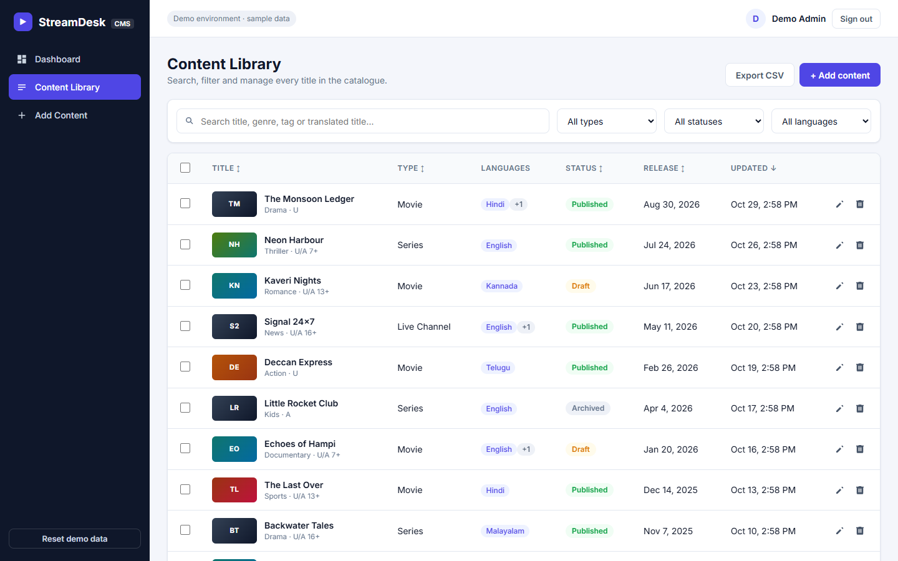
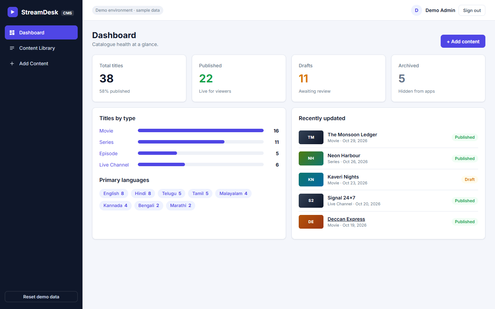
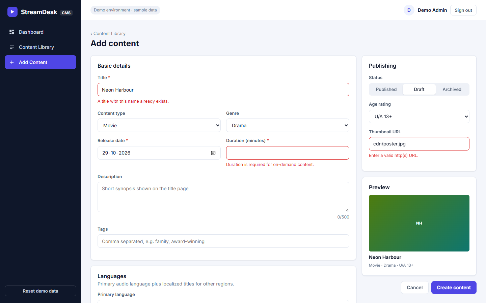
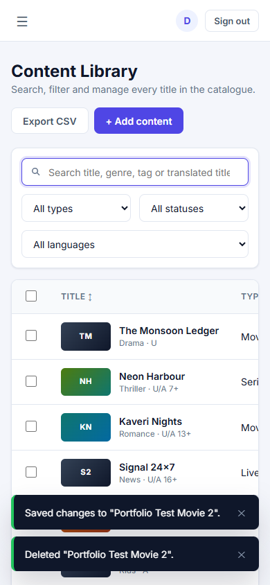

# StreamDesk CMS

An **Angular 22** content management dashboard for an OTT (video streaming) catalogue: movies, series, episodes and live channels.

**Live demo:** https://streamdesk-cms.vercel.app  ·  **Login:** `admin@streamdesk.dev` / `Admin@123` (pre-filled with one click)



> I built StreamDesk as a portfolio project. It recreates the kind of admin tooling I work on professionally, using only fictional sample data and no proprietary code.

## Features

| Area | What it shows |
|---|---|
| **Content list** | Server-side search (debounced with RxJS), filters by type, status and language, column sorting, pagination. All state is kept in the URL, so filtered views can be bookmarked and shared. |
| **Forms** | Typed Reactive Forms for create and edit, with a dynamic `FormArray` for localized titles in multiple languages. |
| **Validation** | Required, length, URL and date-range rules. An **async** validator checks for duplicate titles, and **cross-field** validators require a duration except for live channels and prevent duplicate translation languages. |
| **Edit / delete** | Edit page loads by route param, delete with a confirm dialog, bulk select and delete, and an unsaved-changes `CanDeactivate` guard. |
| **API integration** | A `HttpClient` service layer, an auth interceptor (bearer token, 401 sign-out) and a mock REST backend implemented as an interceptor, so the demo runs on static hosting. |
| **UX** | Dashboard stats, loading and empty states, toast notifications, CSV export, responsive layout with a mobile drawer. |
| **Architecture** | Standalone components, Signals, `OnPush`, zoneless change detection, lazy-loaded routes, functional guards and interceptors. |
| **Tests** | Vitest unit tests for validators, the query/filter logic, CSV export and the HTTP service (`HttpTestingController`). |

| Dashboard | Form validation | Mobile |
|---|---|---|
|  |  |  |

## Tech stack

Angular 22 · TypeScript · RxJS · Signals · Reactive Forms · SCSS · Vitest

## Run locally

Requires Node.js 22.22+.

```bash
npm install
npm start          # http://localhost:4200
npm test           # unit tests
npm run build      # production build in dist/streamdesk-cms/browser
```

## Project structure

```
src/app
├── core
│   ├── models/          # Content types and query models
│   ├── services/        # ContentService, AuthService, toast and confirm services
│   ├── interceptors/    # Auth interceptor + error message helper
│   ├── guards/          # authGuard, guestGuard, unsavedChangesGuard
│   └── mock-api/        # Mock REST backend (interceptor + localStorage DB + seed data)
├── features
│   ├── auth/            # Login page
│   ├── dashboard/       # Stats overview
│   └── contents/        # Content list, add/edit form, CSV export
├── layout/              # App shell with sidebar and top bar
└── shared/              # Custom validators, poster component, toasts, confirm dialog
```

## Connecting a real backend

The app talks to `/api/*` through `ContentService`. To use a real server, remove `mockApiInterceptor` from `app.config.ts` and provide `API_URL` with your server's base URL. The service and components don't need to change.

| Method | Endpoint | Purpose |
|---|---|---|
| `POST` | `/api/auth/login` | Sign in, returns `{ token, user }` |
| `GET` | `/api/contents?q&type&status&language&sort&order&page&pageSize` | Paged list |
| `GET` | `/api/contents/:id` | Single item |
| `POST` | `/api/contents` | Create |
| `PUT` | `/api/contents/:id` | Update |
| `DELETE` | `/api/contents/:id` | Delete |
| `POST` | `/api/contents/bulk-delete` | Delete many `{ ids }` |
| `GET` | `/api/contents/title-available?title&excludeId` | Duplicate check |
| `GET` | `/api/stats` | Dashboard numbers |

## Author

**Latha Kankanala**, Software Engineer (Angular), Hyderabad
[LinkedIn](https://www.linkedin.com/in/latha-kankanala) · [Portfolio](https://latha-kankanala.vercel.app)
